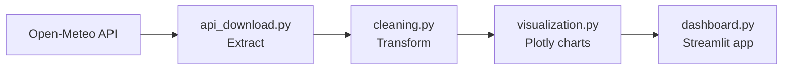

<div align="center">

# 🌫️ Air Quality Monitor – CDMX

**Interactive Streamlit dashboard that tracks air pollution in Mexico City, compares it with WHO guidelines and tells you the best time to go outside.**


</div>

## Overview

The dashboard downloads up to 90 days of hourly air-quality data from the free [Open-Meteo Air Quality API](https://open-meteo.com/en/docs/air-quality-api), cleans it with Pandas and turns it into interactive Plotly charts and plain-language recommendations. No API key is needed.

**Pollutants tracked:** PM2.5, PM10, NO₂, O₃ (ozone) and CO.

## Features

- **KPIs at a glance**: current level, period average, maximum peak and number of records, with a flag when the current value is above the WHO guideline.
- **Time series** with the WHO reference threshold drawn on the chart.
- **Hour × day heatmap** to spot the most polluted hours.
- **Weekly boxplots** showing how pollution varies by day of the week.
- **Automated insights**: the best and worst hours for outdoor activities and the most polluted weekday.
- **Filters**: history length (7–90 days), pollutant and date range.
- **Caching**: responses are cached for one hour with `st.cache_data`, which cuts API calls and speeds up reloads.

## How it works

The code follows a small ETL pipeline, one module per step:



| Step | Module | Details |
|---|---|---|
| Extract | [`src/api_download.py`](src/api_download.py) | `AirQualityFetcher` requests hourly data for the chosen period and handles network and format errors |
| Transform | [`src/cleaning.py`](src/cleaning.py) | `DataCleaner` drops forecast rows, fills short gaps with linear interpolation (max 2 hours), adds hour, date and ordered weekday features, and renames columns |
| Visualize | [`src/visualization.py`](src/visualization.py) | `DashboardPlots` builds the time series, heatmap and boxplot, and stores the WHO limits |
| Serve | [`src/dashboard.py`](src/dashboard.py) | Layout, sidebar filters, KPIs and the automated insights |

WHO guideline values used for the threshold lines (µg/m³): PM2.5 = 15, PM10 = 45, NO₂ = 25, O₃ = 100.

## Getting started

You need Python 3.8 or newer.

```bash
git clone https://github.com/GaneshaDS/AirQuality_Monitor_DS.git
cd AirQuality_Monitor_DS

python -m venv venv
# Windows
venv\Scripts\activate
# Linux / macOS
source venv/bin/activate

pip install -r requirements.txt
streamlit run src/dashboard.py
```

Streamlit opens the dashboard at http://localhost:8501.

### Changing the location

The default coordinates are Mexico City's Zócalo (`19.4326, -99.1332`). To monitor another city, change the defaults of `AirQualityFetcher` in [`src/api_download.py`](src/api_download.py):

```python
def __init__(self, lat=19.4326, lon=-99.1332):
```

## Project structure

```
AirQuality_Monitor_DS/
├── data/
│   └── raw/                  # Sample raw export from the API
├── src/
│   ├── api_download.py       # Extract: Open-Meteo client
│   ├── cleaning.py           # Transform: cleaning and feature engineering
│   ├── visualization.py      # Plotly charts and WHO limits
│   └── dashboard.py          # Streamlit app (entry point)
├── requirements.txt
└── README.md
```

## Roadmap

- [ ] City selector in the sidebar
- [ ] Deploy on Streamlit Community Cloud
- [ ] Add the Mexican air-quality index (Índice AIRE y SALUD)
- [ ] Simple forecasting of the next hours

## Contributing

Contributions are welcome. Please open an issue first to discuss what you would like to change.

## Author

**Heriberto Ganesha Cortés Valdez** · [LinkedIn](https://www.linkedin.com/in/heriberto-ganesha-cort%C3%A9s-valdez-28bbb72b7/) · [ganesha.dev@outlook.com](mailto:ganesha.dev@outlook.com)

## License

Released under the [MIT License](LICENSE). Air-quality data by [Open-Meteo](https://open-meteo.com/) (CC BY 4.0).
